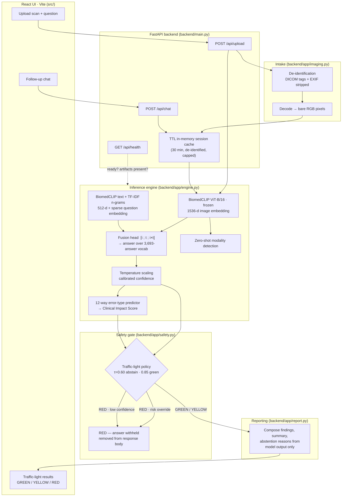
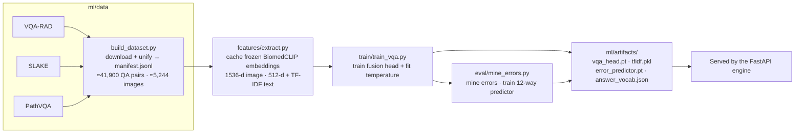

# Diagnex: AI Medical Imaging & Radiologist VQA Portal

> **Research prototype status (27 October 2026):** The figures below use the
> corrected image-disjoint split. A previous run reused 183 VQA-RAD images
> between training and test and has been superseded. See
> [PROJECT_STATUS.md](PROJECT_STATUS.md) for the current model and remaining
> work. No model output is a definitive medical finding.

**Safety-gated medical Visual Question Answering.** Upload an X-ray, CT, MRI,
ultrasound or pathology slide, ask a question in natural language, and get an
answer **together with an honest account of how much to trust it** — or a
refusal, when the model should not be trusted.

> **Screening aid for educational use. Not a medical diagnosis, and not a
> substitute for examination by a qualified doctor.**

The premise, taken from the project's source research: medical VQA models are
*dangerously overconfident when wrong*, with **26.8% of errors** landing in a
"clinical danger zone" where the model is simultaneously incorrect and highly
confident. This prototype estimates uncertainty and can abstain, but it cannot
reliably identify every wrong answer.


---

## Features

- **Multi-modal intake** — X-ray, CT, MRI, ultrasound and histopathology slides,
  uploaded as PNG/JPEG/TIFF or native **DICOM**.
- **Natural-language VQA** — closed (yes/no) and open-ended questions answered
  over a 3,693-answer medical vocabulary.
- **Honest uncertainty gate** — a traffic-light (GREEN / YELLOW / RED) that
  withholds answers rather than bluff, driven by *calibrated* confidence **and**
  a predicted failure mode.
- **Follow-up chat** — de-identified pixels live in a TTL-bounded in-memory
  session cache (30 min), so you can ask a series of questions about one scan.
- **Zero fabrication by design** — every report sentence is derived from model
  output. Withheld answers are removed from the API response body, not flagged.
- **De-identification at the boundary** — DICOM tags and EXIF are stripped
  before pixels reach any other code; nothing is written to disk.
- **Runs on CPU** — the vision transformer is frozen and executed once during
  feature extraction, so the whole system trains and serves on a laptop.

---

## Table of contents

- [How the safety gate works](#how-the-safety-gate-works)
- [What the model actually achieves](#what-the-model-actually-achieves)
- [Architecture](#architecture)
- [Run it locally](#run-it-locally)
- [API reference](#api-reference)
- [The 12-category error taxonomy](#the-12-category-error-taxonomy)
- [Honest limitations](#honest-limitations)
- [Ethics](#ethics)
- [Project layout](#project-layout)
- [Credits](#credits)

---

## How the safety gate works

Confidence alone is not sufficient, so **two signals** drive every decision:

1. **Calibrated confidence.** A raw softmax is systematically overconfident; a
   0.60 cut on uncalibrated scores would not mean what the research says it
   means. A temperature fitted on the validation split (see
   `ml/train/train_vqa.py`) brought test calibration error to **0.073** in the
   current image-disjoint evaluation.
2. **A 12-way error-type prediction** — *if* this answer is wrong, how is it
   most likely wrong? — which feeds an expected **Clinical Impact Score**.

The second signal is what separates this from a plain threshold:

```
confidence 0.92  →  passes the 0.60 gate
                 →  but likely failure mode is "abnormality detection failure"
                    (CRITICAL: the model says normal while a finding is present)
                 →  forced to RED, answer withheld
```

A 92%-confident answer gets withheld because the way it would fail is a missed
tumour. That is the whole idea.

| Band | When | Behaviour |
| :--- | :--- | :--- |
| 🟢 GREEN | ≥ 85% and no high-risk failure mode | Answer shown |
| 🟡 YELLOW | 60–85%, or GREEN downgraded by a high-risk failure mode | Answer shown, verify with a doctor |
| 🔴 RED | < 60%, or a likely CRITICAL failure mode | **Answer withheld**, doctor finder shown |

A withheld answer is *removed from the API response body*, not merely flagged —
the client cannot render what it was never sent.

**Danger zone.** When the model is confident enough to pass the gate but its
expected Clinical Impact Score is severe, the result is flagged explicitly. This
is the confidently-wrong quadrant the research places 26.8% of errors in.

---

## What the model actually achieves

Measured on **8,220 question–answer pairs**, with every test image excluded
from training and validation. Values come from `ml/artifacts/vqa_metrics.json`.

| Metric | Result |
| :--- | ---: |
| Closed questions (yes/no) | 85.7% |
| Open-ended questions | 40.3% |
| Overall | 62.3% |
| Calibration error (ECE) | 0.073 after temperature scaling |

Per dataset:

| Dataset | n | Overall | Closed | Open |
| :--- | ---: | ---: | ---: | ---: |
| SLAKE | 1,061 | 83.7% | 87.6% | 81.6% |
| PathVQA | 6,719 | 59.9% | 86.7% | 33.1% |
| VQA-RAD | 440 | 46.6% | 70.0% | 13.7% |

### The abstention trade-off — the reason this project exists

Withholding low-confidence answers changes the benchmark accuracy among the
questions the model answers. It has not established patient safety:

| Threshold | Answers | Accuracy when it answers | Errors removed |
| :--- | ---: | ---: | ---: |
| no gate | 100% | 62.3% | — |
| τ = 0.50 | 71.1% | 81.8% | 65.7% |
| **τ = 0.60** | **66.4%** | **84.2%** | **72.1%** |
| τ = 0.70 | 61.8% | 86.8% | 78.4% |
| τ = 0.85 | 54.2% | 90.6% | 86.5% |

At τ = 0.60, the confidence-only rule answers 66.4% of test questions and
is right on 84.2% of those answers. The deployed traffic-light rule also uses
the experimental error predictor: it answers 43.7% and is right on 83.7% of
those answers, leaving **585 incorrect answers shown** on this benchmark.

---

## Architecture

### Inference (runtime)

The FastAPI backend is authoritative for safety decisions: it computes
calibrated confidence, predicts the failure mode, applies the traffic-light
policy, and only then composes the patient-facing report. The React UI never
sees an answer the gate refused.



Two design choices worth explaining:

- **`i × t`, not just `[i ; t]`.** Answer priors in medical VQA are strong enough
  that a concatenation-only head scores well while barely consulting the image.
  The multiplicative term forces image and question to agree.
- **TF-IDF alongside the CLIP text embedding.** Contrastive text encoders
  represent negation poorly — "is there a mass" and "is there *no* mass" sit
  close together in CLIP space. Since negation is itself error category 4.1, the
  head needs a representation that separates them.

### Training pipeline

The expensive step runs exactly once: frozen BiomedCLIP embeddings are cached to
disk, after which training the small fusion head takes minutes on CPU.



Everything runs on CPU. The vision transformer executes once during feature
extraction and never again during training — the trainable head is **≈6.6M
parameters** and fits in minutes, which is what makes a laptop viable.

---

## Run it locally

### Prerequisites

- **Python 3.10+** (3.10–3.12 recommended; CPU-only, no GPU or CUDA needed)
- **Node.js 18+** and npm
- ~6 GB free disk if you run the full ML pipeline (datasets + model weights)

> On Windows, some torch builds conflict with MKL's OpenMP at model-construction
> time (`0xC0000005`). The repo already sets `KMP_DUPLICATE_LIB_OK=TRUE` in
> `ml/features/extract.py` and `backend/app/engine.py`, and
> `ml/features/run_extract.py` restarts the extraction step until the cache is
> complete. The CPU-only torch wheels below avoid most of these issues.

### 1. Clone and install

```bash
git clone https://github.com/mansiverma897993/Diagnex.git
cd Diagnex
```

**Python dependencies** (into a virtual environment):

```bash
python -m venv .venv
.venv\Scripts\activate          # Windows PowerShell
# source .venv/bin/activate     # macOS / Linux
```

Then install the ML + backend requirements (the file already pins CPU-only
`+cpu` torch wheels for the no-GPU setup):

```bash
pip install -r ml/requirements.txt
```

Alternatively, if you use `uv`:

```bash
uv venv --python 3.11
uv pip install -r ml/requirements.txt --index-strategy unsafe-best-match
```

**Frontend dependencies:**

```bash
npm install
```

### 2. Build the dataset and train the model

Each step is resumable and safe to interrupt. The first step downloads the three
public datasets; the second is the slow one (frozen feature extraction, once);
the last two train the two heads.

```bash
python ml/data/build_dataset.py       # ≈41,900 QA pairs, ≈5,244 images
python ml/features/run_extract.py     # cache frozen embeddings (slow, once)
python ml/train/train_vqa.py          # train + calibrate the answer head
python ml/eval/mine_errors.py         # error corpus + 12-way error predictor
```

On completion, everything the server needs is in `ml/artifacts/`
(`vqa_head.pt`, `error_predictor.pt`, `tfidf.pkl`, `answer_vocab.json`).

> **Optional configuration.** By default the pipeline targets
> `D:\diagnex\data` and the Hugging Face cache lives in `D:\diagnex\.hf`. To use
> your own locations, set the environment variables first:
>
> ```powershell
> $env:DIAGNEX_DATA  = "D:\data\diagnex"
> $env:HF_HOME      = "D:\cache\hf"
> $env:DIAGNEX_ARTIFACTS = "D:\diagnex\Diagnex\ml\artifacts"
> ```

### 3. Run the backend

```bash
uvicorn backend.main:app --port 8000
```

The API refuses to serve simulated results. `GET /api/health` reports whether
real inference is available; until the pipeline above has run, every analysis
endpoint returns **503 with instructions** rather than a made-up answer.

### 4. Run the frontend

In a second terminal:

```bash
npm run dev
```

### Running the Python FastAPI Backend service

Open **http://localhost:5173**. Uploads and chat questions are sent to the
FastAPI backend at `http://localhost:8000` (override with
`VITE_DIAGNEX_API`). CORS is pre-configured for the Vite dev ports; tighten it
before any deployment via `DIAGNEX_CORS_ORIGINS`.

### Tests

```bash
python -m pytest tests/ -q
```

Unit tests cover the safety gate, error labelling rules and the inference
engine; the end-to-end tests are skipped automatically until the model is
trained.

---

## API reference

| Method | Path | Description |
| :--- | :--- | :--- |
| GET | `/` | Service info + medical disclaimer |
| GET | `/api/health` | `ready: true/false` — never guesses |
| GET | `/api/taxonomy` | The 12 error categories, for the education centre |
| GET | `/api/stats` | Aggregate safety statistics (bands, abstention, danger zone) |
| POST | `/api/upload` | Upload a scan (+ optional question) → full analysis |
| POST | `/api/chat` | Follow-up question about an already-uploaded session |

All analysis endpoints return **503** with the model is untrained, **400** on an
unreadable image, **413** above the 40 MB limit, and **404** for an expired
chat session.

---

## The 12-category error taxonomy

| Code | Category | Risk | Published rate |
| :--- | :--- | :--- | ---: |
| 1.1 | Anatomical Misidentification | HIGH | 30.1% |
| 1.2 | Modality or Plane Confusion | MEDIUM | *provisional* |
| 1.3 | Spatial Reasoning Failure | HIGH | 2.9% |
| 2.1 | Granularity Mismatch | MEDIUM | 12.4% |
| 2.2 | Category Domain Confusion | HIGH | 19.0% |
| 2.3 | Attribute Description Error | MEDIUM | *provisional* |
| 3.1 | **Abnormality Detection Failure** | **CRITICAL** | 13.2% |
| 3.2 | False Positive Hallucination | HIGH | 14.2% |
| 3.3 | Counting Error | MEDIUM | 10.0% |
| 3.4 | Localisation Error | HIGH | *provisional* |
| 4.1 | Negation Comprehension Failure | HIGH | 0.5% |
| 4.2 | Question Misinterpretation | MEDIUM | *provisional* |

Eight categories and their prevalence figures are transcribed from the project's
source research. The research states the taxonomy has 12 categories but
enumerates only 8; **the remaining four are reconstructed from the numbering
gaps and are labelled provisional everywhere they appear** — in the API, in the
UI and in reports. They are never presented as published findings.

### Where the error corpus comes from

The mentor's 1,975-error annotated dataset was not available, so the corpus is
generated instead: run the trained model over held-out data, take every wrong
prediction, and classify *how* it was wrong using deterministic, inspectable
rules (`ml/eval/error_rules.py`). This yields 5,932 rule-labelled or fallback-labelled errors.

Its quality is measured rather than assumed. SLAKE annotates every question with
a `content_type` assigned by its authors independently of this project, which
gives a check on the labeller:

| Dataset | Rule coverage | Independent agreement |
| :--- | ---: | ---: |
| SLAKE | 88% | 63.9% |
| VQA-RAD | 70% | — |
| PathVQA | 40% | — |

**The labeller has limited coverage, especially on histopathology free-text.**
PathVQA answers are long descriptive phrases that curated term lists match
poorly, and since PathVQA is 78% of the data it drags the aggregate down to 44.9%
coverage. This is a real limitation, not a rounding detail — see below.

---

## Honest limitations

- **This is not a diagnostic tool at this accuracy.** It scores 62.3% overall
  and 46.6% on VQA-RAD. The traffic-light policy still shows 585 wrong answers
  on the held-out benchmark.
- **Open-ended accuracy is weak (40.3%).** The answer vocabulary covers 87.3%
  of test answers; the remaining 12.7% are unreachable by construction and counted
  as wrong.
- **VQA-RAD is the weakest split (46.6%)** — only 1,574 training rows remain
  after image-disjoint splitting, which is very little to learn from.
- **Error-corpus labelling covers 44.9% of errors.** The rest receive a fallback
  label routed by question form, marked `rule_confident: false` and reported
  separately rather than hidden.
- **The error-type predictor scores 59.3%** against rule-derived labels over
  12 classes (chance ≈ 8.3%). Its output is not a validated clinical risk score.
- **Our error distribution differs from the published aggregate**, mostly
  because our training mix is 78% PathVQA and the published aggregate is not.
  Comparison is done per dataset in `ml/eval/mine_errors.py`, which is the
  like-for-like view.
- **Four taxonomy categories are provisional** pending confirmation.

---

## Ethics

- Only public research datasets: **VQA-RAD**, **SLAKE**, **PathVQA**. No patient
  images.
- DICOM identifiers and EXIF are stripped at the intake boundary, before pixels
  reach any other code, so nothing downstream can persist an identifier.
- De-identified images live in a TTL-bounded in-memory cache so follow-up
  questions work; **nothing is written to disk**.
- Every screen and every report carries the medical disclaimer.
- The system refuses to start rather than serve simulated results.

---

## Project layout

```
backend/
  main.py                 FastAPI endpoints (upload, chat, health, stats)
  app/
    imaging.py            DICOM/image intake and de-identification
    engine.py             inference: frozen towers + trained heads
    taxonomy.py           12 categories, risk tiers, CIS weights
    safety.py             traffic-light gate, abstention, danger zone
    lexicon.py            curated medical term sets, answer normalisation
    report.py             patient-facing text, derived only from model output
ml/
  data/build_dataset.py   download + unify the three datasets
  features/extract.py     cache frozen BiomedCLIP embeddings
  features/run_extract.py restart-until-complete wrapper (Windows OpenMP fault)
  train/train_vqa.py      train + calibrate the answer head
  eval/error_rules.py     12-way rule-based error labeller
  eval/mine_errors.py     error corpus + error-type predictor
src/App.jsx               React UI
tests/                    safety, error-labelling, engine and E2E tests
```

---

## Credits

B.Tech final year project, Department of CSE, KIET Group of Institutions.
Mentor: Dr. Gaurav Dubey. Safety methodology — error taxonomy, τ = 0.60
abstention threshold, Clinical Impact Score — follows his published research.

